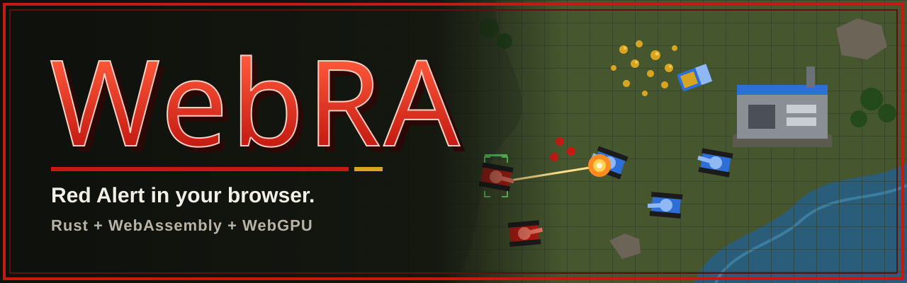
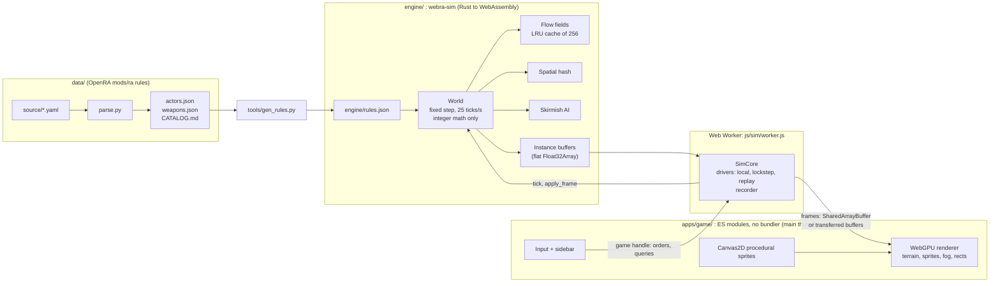

<p align="center">
  
</p>

<p align="center">
  <a href="https://github.com/SherinBloemendaal/webra/actions/workflows/ci.yml"></a>
  
  
  
  
</p>

# WebRA

**WebRA** is a browser-native real-time strategy game inspired by *Command & Conquer: Red Alert* (1996) and the open-source [OpenRA](https://www.openra.net/) engine. The goal is Red Alert gameplay that runs in a browser tab: no install, no plugin, just a deterministic Rust simulation compiled to WebAssembly and drawn with WebGPU.

It is modernised where it helps (large unit counts, flow-field pathfinding, a lockstep-ready simulation) and deliberately old-fashioned where it matters: the look.

## Why the simple art style

WebRA keeps the plain, flat look of 1996: simple shapes, solid team colours and readable silhouettes instead of hyper-detailed textures. Simple images are easier to recognise at a glance and easier to remember, which is exactly what you want when a hundred units are moving across the screen. All sprites are generated procedurally at startup with Canvas2D (at 2x resolution), and the terrain tiles of each biome are computed pixel by pixel at game start, so the project ships no image assets at all.

## Features

Play it at **[webra.sherin.dev/play](https://webra.sherin.dev/play/)** (site: [webra.sherin.dev](https://webra.sherin.dev/)).

### Game modes
- [x] Skirmish against the AI with **2 to 8 players**: free for all or teams (allies share vision and win together), AI at Easy, Normal or Hard
- [x] The AI uses the whole arsenal: helicopters and planes (away from heavy anti-air), naval yards and warships where water reaches the enemy, minefields, chrono tanks, MAD tanks and demolition trucks, radar jammers, and on Hard (Normal after 15 minutes) the Iron Curtain, Chronosphere and Atom Bomb, never where allies would be hit
- [x] **Online multiplayer**: anyone can host a session, public (listed in the server browser) or private, optionally password protected; deterministic lockstep over WebSockets on Cloudflare Durable Objects, with desync detection
- [x] **Reconnecting**: a player whose connection drops (or who reloads the page) rejoins the running game within 2 minutes; the server keeps the game's order log, the client fast-forwards to the current tick, checks the state hash and takes its seat back. The game never pauses for a missing player
- [x] **Spectators**: lobby places for observers (the host picks 0 to 8, same password rules), also joining a game in progress; they watch the whole map or any player's view, with observer stats (cash, income, army value, kills and losses per player) and can never give orders
- [x] **Replays**: every game (skirmish and online) is recorded as start settings plus order frames; download it from the game menu or the game over screen and watch it with play, pause, 1x to 8x speed, seeking and the player view switcher. Replays from another WebRA version say so instead of playing wrong
- [x] **Save and load** for skirmish: save to the browser or to a file from the game menu, continue later with Load game; loading re-simulates the game and checks its state hash
- [x] **Map editor** at [/play/editor/](https://webra.sherin.dev/play/editor/): paint terrain and ore, place spawns and actors, symmetry tools, undo/redo, validation, test play, publish to the community map list
- [x] **Custom maps and modded rules** (the rules.ini idea): a map can override unit and weapon values; players see a MODDED warning and must accept it before the map is installed, online and offline
- [x] **OpenRA maps**: import `.oramap` files in the lobby and the map editor; the browser unpacks the package (with zip bomb limits), converts terrain from the Red Alert tilesets, ore and gems, trees, spawns and known actors, maps rules values onto WebRA's modded rules, and shows an import report of what was converted, skipped or not supported (Lua is never run)
- [x] Lobby options like OpenRA: starting cash and units (MCV only, light or heavy support, construction yard), tech level, game speed, fog of war, explored map, build radius, redeployable MCVs, ore regrowth; plus map style, biome and weather
- [x] Stress test mode (tens of thousands of units)

### Content (all Red Alert ground, naval and air units and structures, from OpenRA's rules)
- [x] Every building and defence: power plants, refinery, silo, barracks, kennel, war factory, service depot, radar dome, helipad, airfield, naval yard, sub pen, tech centers, walls, pillboxes, turret, flame tower, Tesla Coil, AA gun, SAM site, gap generator, France's decoys
- [x] Every ground vehicle: Ranger, APC, Mobile Flak, light, medium, heavy and Mammoth tanks, V2, artillery, Minelayer, Radar Jammer, Mobile Gap Generator, Tesla Tank, Demolition Truck, Chrono Tank, Phase Transport, Supply Truck, MAD Tank, MCV, ore truck
- [x] **Boats**: Gunboat, Destroyer, Cruiser, Transport (LST), Submarine and Missile Submarine; submarines dive and surface, depth charges, naval repair
- [x] **Helicopters**: Chinook (troop transport), Black Hawk, Longbow and the Hind (disabled in OpenRA, restored here); hovering, landing, ammo and rearming at helipads
- [x] **Planes and air support powers**: Yak and MiG attack runs with ammo and rearming at airfields; Spy Plane, Paratroopers and Parabombs
- [x] **Abilities and superweapons**: minefields, cloaking and detection, missile jamming, gap generators, chrono teleport, demolition and MAD tank detonations, cash delivery; Chronosphere, Iron Curtain, Atom Bomb and GPS satellite
- [x] Transports: infantry ride in APCs, Rangers, Phase Transports, the LST and the Chinook
- [x] Tech tree with real OpenRA prerequisites for 7 factions; the sidebar shows every item and what is still needed to unlock it

### Gameplay
- [x] Ore economy with regrowth, refinery and silo storage, power with low-power slowdown and shutdown of powered defences
- [x] Classic production queues (Buildings, Defense, Infantry, Vehicles, Aircraft, Naval), OpenRA placement rules, selling, MCV deploy and pack-up
- [x] OpenRA weapon data: range and minimum range, burst, projectile speed and inaccuracy, warheads with spread, falloff, delays and armour versus tables, death explosions, crushing
- [x] **Radar minimap** in the sidebar while you own a powered Radar Dome: terrain, ore and gems, shroud and fog, units and structures in team colours (only what you can see), the camera frame; click or drag to move the camera, right click to send the selected units. It opens and closes with an animation and shows static on low power or when an enemy **Mobile Radar Jammer** comes within 18 cells of the dome; jammers also hide everything hostile around them from enemy radar
- [x] **Veterancy** like OpenRA: kills earn experience worth the victim's value; units rank up three times to veteran and then to elite (chevrons and a star over the unit, rank and experience in the selection panel) and gain firepower, armour, speed and faster reloads; elite units repair themselves
- [x] **Infantry go prone** under fire: soldiers hit by bullets and explosions drop to the ground, take half damage and crawl at half speed until they have not been hit for two seconds
- [x] **Command bar** at the bottom left like OpenRA: attack move, force move (Alt + click), force attack and attack ground (Ctrl + click), guard (D or G), scatter (X), stop, deploy and queued waypoints (Shift + click), plus OpenRA's **fire stances** per unit (attack anything, defend, return fire, hold fire; C cycles); idle units return fire, and the health of what your units attack or what is under the mouse is shown
- [x] OpenRA style overlays: selection corner brackets in the owner's colour, thin segmented health bars (green, yellow, red) for the selection, what it attacks and the unit under the mouse, optionally for all damaged or all units (Settings), rank chevrons next to the bar
- [x] Animated buildings like Red Alert: turning radar dishes, chimney smoke, blinking beacons and runway lights, turbine fans, the construction yard's crane hook; they pause with the game and stand still for prefers-reduced-motion
- [x] Fog of war and shroud with remembered enemy buildings; classic left-click orders with custom cursors, attack-move, rally points, control groups, numpad sidebar hotkeys, pause
- [x] Red Alert style interface in the spirit of OpenRA: gunmetal chrome with bevels and rivets in your side's colour (steel blue Allies, red Soviets), a sidebar with command buttons, radar slot, money and game clock, a vertical power meter, production tab icons and a three-column build grid with clock-wipe progress, time left, queue counts and Ready labels; announcer lines also appear as text at the bottom of the screen ("Unit ready. (3)"), with sound on or off
- [x] Fair generated maps: mirrored left to right; with 3 to 8 players every base gets the same pocket, shifted and never rotated, because Red Alert structures face south
- [x] **Varied maps** per seed or picked in the lobby: open plains or cliffs and passes, river valleys with fords, lake districts, and islands with straits; water forms one connected network, every base gets an equal harbour on it, and ground routes over water become fords that ships still pass. Ore and gems follow the layout (river crossings, islands, passes)
- [x] **Biomes**: temperate, snow and desert, each with its own terrain art (snow and ice, sand and dunes, cliffs drawn as raised plateaus lit from the top left, shorelines with foam, conifers, cacti and palms, scattered stones, craters and shrubs), stored in map files and chosen in the lobby or the map editor
- [x] **Weather**, deterministic for every player: rain and thunderstorms (lightning and thunder, harmless), snowfall, sandstorms and heat waves. Modest effects: shorter sight in bad weather, vehicles slide on snow and ice, infantry wade a little slower, and in a heat wave vehicles that keep driving or firing overheat (slower and firing slower until they cool, with a heat shimmer). A HUD badge says what the weather does; the lobby can make weather cosmetic only or turn it off. Particles are drawn on the GPU and capped; lightning respects reduced motion

### Phones and tablets
- [x] **Touch controls** with Pointer Events (mouse play unchanged): tap to select or give the order, double tap for every unit of that type on screen, drag to box select, two fingers to pan and pinch to zoom, long press to force attack or attack-move
- [x] Touch action bar for what the keyboard does on desktop: Add (Shift), attack move, force attack, stop, deploy, select all, cancel; building placement by dragging the footprint with Place and Cancel buttons; support powers aimed by tap
- [x] Phone layouts: the build sidebar becomes a collapsible drawer (bottom in portrait, right in landscape), 44 px touch targets, safe-area insets for notches, compact HUD, Menu button for the game menu; the lobby and the website work at phone width
- [x] Render resolution cap and a low quality setting for mobile GPUs

### Sound
- [x] Our own sounds, synthesized in the browser with Web Audio (no audio files): weapon fire per weapon class, explosions by size, splashes, radio replies, announcer cues, structure placement and selling
- [x] Unit replies and announcer lines ("Construction complete", "Unit ready", "Insufficient funds", "Low power", "Our base is under attack", "Unit lost", ...), optionally spoken with the browser's speech synthesis
- [x] Positional sound: volume and stereo pan follow the camera, sounds outside the view or under fog are culled, and a per-frame voice budget keeps battles of thousands of units listenable
- [x] **Install original Red Alert content** like OpenRA: pick `main.mix`, `redalert.mix` or other `.mix`/`.aud` files from your own copy (Red Alert is freeware since 2008); WebRA reads the MIX archives (including the encrypted index) and decodes the AUD sounds in the browser, and stores them on your device only. Originals then replace the synthesized sounds (switchable), and the soundtrack plays in games
- [x] Settings for master, effects, voices and music volume, speech and originals (the **Sound** button)

### Engineering
- [x] Deterministic integer-only simulation in Rust, compiled to WebAssembly, rendered with WebGPU
- [x] Over 200 automated tests: engine (including AI vs AI games, fairness, and fuzzing of hostile orders and modded rules), WebAssembly API, protocol, server, map format, editor, touch gestures and layouts
- [x] Security review of multiplayer with every finding fixed: see [docs/security.md](docs/security.md)
- [x] CI on every push, semantic versioning from Conventional Commits, automatic deploys to Cloudflare

## Roadmap

- [x] Minimap / radar (Radar Dome) and radar jamming
- [x] Veterancy, infantry prone
- [x] Fire stances (attack anything, defend, return fire, hold fire) and the command bar
- [x] Reconnecting to an online game, spectators, replays (record orders), save/load
- [x] Simulation in a Web Worker with SharedArrayBuffer (transferred buffers, or the main thread, as fallbacks)
- [ ] GPU compute for very large crowds: measured and not worth it yet, see [Determinism and performance](#determinism-and-performance)
- [x] Loading OpenRA `.oramap` maps
- [x] In-game menu (Esc) with settings and rebindable hotkeys (OpenRA defaults), fullscreen
- [x] Mobile/touch controls

## Architecture



**Simulation (`engine/`).** The `webra-sim` crate is compiled to WebAssembly with `wasm-bindgen` and `wasm-pack`. It runs a fixed-step simulation at 25 ticks per second (OpenRA timing) using integer math only: 1024 world units per cell, 1024 angle units per full turn and an integer sine table. No floating point touches game state, so two machines fed the same orders compute the same world. A state hash is exposed for desync checks.

**Pathfinding.** Movement uses flow fields: a Dijkstra integration field per goal cell and locomotor. Fields are cached in an LRU of 256 entries and rebuilt lazily when passability changes. Connectivity labels detect unreachable goals, which snap to the nearest reachable cell. Many units ordered to the same goal share one field.

**Spatial hash.** Rebuilt every tick with a counting sort, it serves crowd separation, target scanning and splash damage.

**Simulation worker (`apps/game/js/sim`).** The game runs in a dedicated module Web Worker: the wasm `Game`, the driver that decides when it ticks (skirmish and saves, online lockstep, replays) and the recorder. The main thread keeps rendering, input and UI and never waits for a tick. It sends each animation frame's time with the camera rectangle and gets back the newest frame: instance buffers, fog, terrain changes, sound events, an actor table (owner, kind and type per actor) and answers to the UI's queries. UI code talks to a game handle with the `Game`'s method names: orders go to the worker in order, queries answer synchronously from the last frame (a frame old, like the picture), and clicks and keys ask the worker for fresh answers before they act. Render data travels through SharedArrayBuffers (a double buffer with sequence counters) when the page is cross-origin isolated, else as transferred ArrayBuffers, and the main thread runs the same code itself when module workers are unavailable. The debug menu's performance stats show the mode; `?sim=direct|transfer|shared` picks one for testing. [docs/contracts.md](docs/contracts.md) (section 8) has the boundary method by method.

**Rendering (`apps/game/`).** Plain ES modules, no bundler. The WebGPU renderer uses WGSL shaders in `apps/game/shaders` for terrain, instanced sprites with team colour masks, fog of war and rectangles. Rust writes instance data into flat `Float32Array`s, which the worker hands to the main thread and the renderer uploads to the GPU.

## Project layout

A monorepo; [docs/contracts.md](docs/contracts.md) defines how the parts fit together.

```
webra/
├── engine/                 webra-sim: deterministic simulation (Rust, compiled to WebAssembly)
│   ├── rules.json          generated rules, embedded in the wasm
│   ├── src/                world, units, combat, production, map, flowfield, vision, ai, render, tests
│   └── examples/           ai_vs_ai.rs (headless match), stress.rs (benchmark), fairness_n.rs (N-player fairness probe), ai_probe.rs
├── apps/
│   ├── game/               browser client, served at /play (ES modules, WebGPU, no bundler)
│   ├── website/            landing site, served at /
│   └── server/             Cloudflare Worker: static hosting, API, multiplayer sessions
├── packages/
│   └── protocol/           multiplayer messages shared by game and server
├── data/                   Red Alert catalog extracted from OpenRA mods/ra
├── tools/                  gen_rules.py, gen_oramap_tables.py, gen-audio-catalog.mjs, shader-check (naga), check-js.mjs
└── docs/                   contracts, README assets
```

## Getting started

You need a Rust toolchain, `wasm-pack` and Python 3 (only for the static file server and the data tools).

```bash
rustup target add wasm32-unknown-unknown
cargo install wasm-pack
npm install
npm run build:wasm
python3 -m http.server 8080 --directory apps/game
```

Then open <http://localhost:8080> in a browser with WebGPU support: Chrome or Edge 113+, Safari 26+, or Firefox 141+ on Windows.

Python's server sends no COOP/COEP headers, so the simulation worker uses transferred buffers there; `npm run build` and then `npx wrangler dev` in `apps/server` serve `dist/` with `apps/website/_headers`, which gives the SharedArrayBuffer mode.

### Other commands

| Task | Command |
|------|---------|
| Everything CI runs (engine tests, wasm build, JS checks, API tests) | `npm test` |
| Run the simulation tests | `cargo test -p webra-sim --release` |
| Headless AI vs AI match (seed 7) | `cargo run -p webra-sim --release --example ai_vs_ai -- 7` |
| Fairness of generated maps (4-player FFA, 48 seeds) | `cargo run -p webra-sim --release --example fairness_n -- 0000 48` |
| Headless stress benchmark | `cargo run -p webra-sim --release --example stress -- 20000` |
| Main thread cost per frame, simulation in a worker or not (after `npm run build:wasm`) | `node tools/sim-bench.mjs 20000` |
| Regenerate `engine/rules.json` | `python3 tools/gen_rules.py` |
| Regenerate the `.oramap` import tables | `python3 tools/gen_oramap_tables.py` |
| Validate the WGSL shaders | `cargo run -p shader-check` |

## Controls

Press **Esc** in a game (or the cog button at the top of the sidebar, or **Menu** on phones) for the game menu: settings (scroll speeds, unit paths, render resolution and low quality, fullscreen) and the full list of controls, where every hotkey can be rebound (saved in the browser). Hotkey defaults follow OpenRA's Red Alert set wherever WebRA has the feature.

| Input | Action |
|-------|--------|
| Left click | Select. With your units selected: give the order (move, attack, harvest, dock or repair); left click one of your own units to select it instead |
| Drag box | Select units. If the box contains combat units, only those are selected (ore trucks stay out of army drags) |
| Shift + click / drag | Add to (or remove from) the selection |
| Double click | Select all units of that type on screen |
| Ctrl + double click | Select all units of that type on the map |
| Right click | Clear the selection (or cancel placement / attack-move / targeting) |
| Factory selected + left click on the ground | Set its rally point |
| A + left click | Attack-move |
| S | Stop |
| F (or D) | Deploy an MCV, pack up a Construction Yard, unload a transport, use a unit ability |
| Z | Sell mode |
| Q | Select all units on screen (press twice: on the whole map) |
| W | Select units of the selected types on screen (press twice: on the whole map) |
| Ctrl + 1..9, 0 (Cmd on macOS) | Store the selected units as a control group (a unit is in one group at a time) |
| 1..9, 0 | Select a control group; press twice quickly to centre the camera on it |
| Shift + 1..9, 0 | Add a control group to the selection |
| E R T Y U I | Buildings, Defense, Infantry, Vehicles, Aircraft, Naval tab |
| Tab / Shift + Tab | Next / previous sidebar tab |
| Numpad 1..9 | Build that sidebar card (Shift: 5, Ctrl: cancel one) |
| Numpad + / - / 0 | Next / previous sidebar tab |
| Numpad . | Cancel building placement |
| Arrow keys / screen edges | Pan the camera (the cursor turns into a scroll arrow at the edges) |
| Alt + arrow keys | Jump to that map edge |
| Middle mouse drag | Pan the camera |
| Radar: left click or drag, right click | Move the camera there; order the selected units there |
| Mouse wheel, ] and [, . | Zoom in, zoom out, reset zoom |
| H or Space | Center on your base |
| Home | Center on the selection |
| F1..F4, Shift + F1..F4 | Jump to / save a camera bookmark |
| Esc | Cancel placement, targeting, sell mode or attack-move; otherwise open the game menu |
| F10 | Game menu |
| P or Pause | Pause (single player; opens the menu) |
| Alt + Enter | Fullscreen |
| L | Show or hide unit paths: selected units draw their planned route (green move, orange attack-move, red chase, yellow ore truck); also in the game menu |
| Sidebar left click | Build or queue, structures too (Shift + click queues 5) |
| Sidebar right click | Cancel the last queued one (refunds what was paid) |
| Click a finished building in the sidebar | Start placing it (the next queued one starts once it is placed) |

Every order type has its own cursor (move, attack, attack-move, harvest, dock, repair, rally, select, place).

### Touch (phones and tablets)

Touch and pen input works next to the mouse and keyboard; the touch action bar appears at the bottom left of the battlefield on touch screens.

| Gesture or button | Action |
|-------------------|--------|
| Tap | Select. With your units selected: give the order (move, attack, harvest, dock, repair, rally point); tap one of your own units to select it instead |
| Double tap | Select all units of that type on screen |
| Drag | Box select. In a targeting mode (attack move, force attack, sell, abilities): aim, then lift to act |
| Two-finger drag | Pan the camera |
| Pinch | Zoom |
| Long press | Units selected: force attack the unit or building under the finger (your own too), or attack-move to the ground. Otherwise: cancel the current mode or clear the selection (the right click) |
| **Add** | Stands in for Shift: taps and boxes add to (or remove from) the selection, attack move and sell mode stay active, sidebar cards queue 5 |
| **A-Move**, **Force** | Attack move or force attack with the next tap |
| **Stop**, **Deploy**, **All**, **Cancel** | Stop; deploy, unload or use an ability; select everything on screen (twice: the whole map); cancel the mode or clear the selection |
| Placing a building | Tap or drag anywhere to move the footprint, then **Place** (or **Cancel**) |
| Support power | Tap the target; drag from the target to choose the direction aircraft fly in |
| Long press a sidebar card | Cancel the last queued one |
| **Build** / **Map** (phones) | Show or hide the build sidebar drawer; it also tucks away while you place a building |
| **Menu** | Game menu (pause, settings, controls, sound, leave) |

Browser gestures (page scroll, pinch zoom, double-tap zoom) are turned off over the battlefield only. On phones with a high pixel density, lower **Max resolution** or turn on **Low quality** in Settings when the frame rate drops.

Notes on browsers:

- **Pause.** Single player and skirmish pause while the menu is open. Online games cannot pause: the lockstep server drops a player who holds the game up for more than 10 s (see [docs/contracts.md](docs/contracts.md)), so the menu opens over the running game and says so. A dropped player can rejoin (the tab reconnects by itself).
- **Replays.** In the replay viewer, P plays and pauses; the bar at the bottom sets the speed and seeks.
- **Ctrl/Cmd + number.** Some browsers switch tabs with these. WebRA holds them back while the game has focus wherever the browser lets a page do that. In fullscreen, Chromium browsers lock Esc, Tab, F1..F4 and the digit row to the game (Keyboard Lock API; hold Esc to leave fullscreen). On macOS, Ctrl + number works as well as Cmd + number.
- **Fullscreen.** F11 belongs to the browser, so the game uses Alt + Enter (or the button in the menu). Without the Fullscreen API the menu says so.
- **Camera bookmarks.** OpenRA saves them with Ctrl + Q/W/E/R, but browsers keep Ctrl + Q and Ctrl + W (quit, close tab), so WebRA uses Shift + F1..F4 to save and F1..F4 to jump.
- **Leaving.** Closing or reloading the tab during a game asks first.

## Data

[data/CATALOG.md](data/CATALOG.md) is the full Red Alert catalog extracted from OpenRA's `mods/ra` rules: 94 buildable actors and 77 weapons, with inheritance resolved and the tech tree solved per faction. The machine-readable versions are [data/actors.json](data/actors.json) and [data/weapons.json](data/weapons.json); the original YAML and the scripts that produced them (`parse.py`, `gen_md.py`) live in [data/source](data/source).

`tools/gen_rules.py` picks the actors needed for the current milestone and writes `engine/rules.json`, which is embedded in the WebAssembly module.

`tools/gen_oramap_tables.py` turns OpenRA's Red Alert tilesets (`data/source/tilesets`) and decoration and civilian actors (`data/source/rules`) into the lookup tables of the `.oramap` importer (`apps/game/js/oramap/tables.js`).

## Determinism and performance

- **Fixed step, integer only.** 25 ticks per second, world units of 1024 per cell, angles of 1024 per turn, an integer sine table and a seeded RNG. This is what will make lockstep multiplayer possible: peers only exchange orders and compare state hashes.
- **Tested.** The test suite includes full AI vs AI games played to completion.
- **Shared flow fields.** A crowd ordered to one goal costs one field, not one path search per unit.
- **Cheap neighbourhood queries.** The per-tick spatial hash keeps separation, targeting and splash damage close to linear.
- **Off the main thread.** The simulation runs in a Web Worker; instance buffers reach the main thread through shared memory (or transferred buffers) without JavaScript-side object churn.
- **Numbers.** Native benchmark of two armies attack-moving into each other (`cargo run -p webra-sim --release --example stress -- 20000`), against a 40 ms tick budget:

  | Units | Average | Worst tick |
  |------:|--------:|-----------:|
  | 10,000 | 3.5 ms | 11 ms |
  | 20,000 | 6.9 ms | 37 ms |
  | 50,000 | 18.6 ms | 74 ms |

  WebAssembly runs the same code somewhat slower than native; the stress test HUD and the debug menu's performance stats show the live ms per tick.
- **Main thread per frame.** `node tools/sim-bench.mjs 20000` (after `npm run build:wasm`) runs the 20,000 unit stress test headless at 60 frames per second with the whole map in view (15,000 sprites) and times what the main thread does per frame: step the simulation or post the step, handle the frame message, and copy the render data as the renderer's `writeBuffer` does. Measured on an Apple Silicon Mac with Node 26 (no browser, no GPU):

  | Simulation runs | Main thread per frame (avg / p95 / max) | Ticks per second |
  |-----------------|----------------------------------------:|-----------------:|
  | Main thread (`direct`, as before) | 6.33 / 16.83 / 70.66 ms | 25.0 |
  | Worker, transferred buffers | 0.08 / 0.12 / 0.85 ms | 24.9 |
  | Worker, SharedArrayBuffer | 0.08 / 0.10 / 0.87 ms | 24.9 |

  Ticks now cost the worker (6 ms per frame on average, up to 50 ms) instead of the main thread, so a heavy tick no longer drops animation frames or delays input. Browser frame times (GPU upload, compositing) were not measured.
- **GPU compute, evaluated.** The simulation stays on the CPU with integer math for determinism; a WebGPU compute pass could only take over presentation work: interpolating, culling and ordering sprite instances. In the engine that work is `build_render`, which takes 0.48 ms (p95 0.58 ms) for those 15,000 sprites, and it now runs in the worker, not on the main thread. The main thread's remaining 0.08 ms per frame is mostly the copy into GPU buffers, which a compute pass would still need (it would read raw previous and current positions instead). There is nothing on the main thread for it to win, so WebRA keeps the CPU path. Revisit it if instance counts grow by an order of magnitude or if the per-frame upload shows up in browser profiles.

## Credits

- **[OpenRA](https://github.com/OpenRA/OpenRA)**: the open-source reimplementation of the classic Westwood RTS games. WebRA's gameplay values (costs, build times, health, armour, weapons, prerequisites, timing) come from OpenRA's `mods/ra` rules, which are licensed under GPLv3. Many thanks to the OpenRA contributors.
- **Westwood Studios and Electronic Arts**: for the original *Command & Conquer: Red Alert*.

*Command & Conquer* and *Red Alert*, and the names of their units, buildings and factions, are trademarks or property of Electronic Arts. WebRA is an unofficial fan project and is not affiliated with or endorsed by Electronic Arts or the OpenRA project. It contains **no original game assets**: all graphics are generated procedurally by the game at runtime and all sounds are synthesized. Players who own Red Alert can install its original sounds from their own files; they are read and stored in the player's browser only and never uploaded or distributed.

## License

WebRA is licensed under the **GNU General Public License v3.0 or later** (GPL-3.0-or-later), because it derives its game data from OpenRA's GPLv3 rules. See [LICENSE](LICENSE) for the full text.
