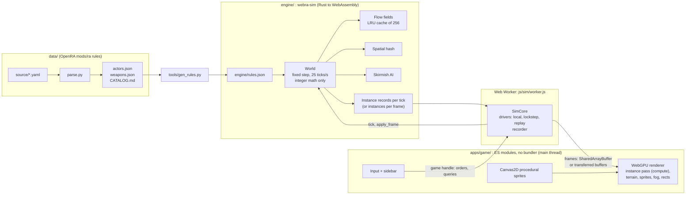

<p align="center">
  
</p>

<p align="center">
  <a href="https://github.com/SherinBloemendaal/webra/actions/workflows/ci.yml"></a>
  
  
  
  
</p>

# WebRA

**WebRA** is a browser-native real-time strategy game inspired by *Command & Conquer: Red Alert* (1996) and the open-source [OpenRA](https://www.openra.net/) engine. The goal is Red Alert gameplay that runs in a browser tab: no install, no plugin, just a deterministic Rust simulation compiled to WebAssembly and drawn with WebGPU.

It is modernised where it helps (large unit counts, flow-field pathfinding, a lockstep-ready simulation) and deliberately old-fashioned where it matters: the look.

## Why the simple art style

WebRA keeps the plain, flat look of 1996: simple shapes, solid team colours and readable silhouettes instead of hyper-detailed textures. Simple images are easier to recognise at a glance and easier to remember, which is exactly what you want when a hundred units are moving across the screen. All sprites are generated procedurally at startup with Canvas2D (at 2x resolution), except the oil derrick, the Black Hawk and the Mobile Flak, WebRA's own pixel art in Red Alert's style painted by a script (`tools/gen_pixel_art.py`), and the terrain tiles of each biome are computed pixel by pixel at game start, so the project ships no image assets at all.

## Features

Play it at **[webra.sherin.dev/play](https://webra.sherin.dev/play/)** (site: [webra.sherin.dev](https://webra.sherin.dev/)). Playing needs a WebRA account while the site setting `gameRequiresAccount` is on (the default): sign up on the [account page](https://webra.sherin.dev/account/), and once the account is active (closed beta: an admin approves it) the game opens. The server enforces this for every game file, not only the start page ([security notes](docs/security.md#the-play-gate-2026-10-09)).

### Game modes
- [x] **Campaign**: OpenRA's Red Alert missions with their maps, rules and Lua scripts, run inside the deterministic simulation: the Allied and Soviet campaigns, the Counterstrike and Aftermath missions, OpenRA's own and the ant missions (60 in all). The Campaign button of the lobby lists them with map, briefing, difficulty and game speed; chapters open as you win (progress follows your account). In a mission: objectives panel, mission messages and timers, the scripts' speech, camera moves and radar pings, the original movies when you installed them from your own copy (else a card in their place), next mission, restart, save and load, replays
- [x] Skirmish against the AI with **2 to 8 players**: free for all or teams (allies share vision and win together); each AI plays one of **OpenRA's Red Alert bots** (Rush, Normal, Turtle or Naval AI, with OpenRA's build orders, unit mixes, squads, base expansion, repairs, power management and support power rules) at Easy, Normal or Hard
- [x] **Fair AI target choice** in free for alls: each AI attacks the nearest base (measured to the starting yard, so an expansion does not draw attacks), and among equally near ones first a player that recently hit its structures, then the one the fewest other AIs already attack, then the next base around the map in a direction the seed picks; strength no longer matters, so two AIs do not gang up on the weakest neighbour (often you, early on). An AI keeps its target until another is clearly better instead of switching every minute
- [x] The AI uses aircraft (away from heavy anti-air), naval yards and warships by water, minefields (Turtle AI), engineers on neutral tech buildings and oil derricks, the spy plane, paratroopers, parabombs and the Atom Bomb like OpenRA's bots, and (not on Easy) the Iron Curtain, Chronosphere and Sonar Pulse, never where allies would be hit
- [x] **Online multiplayer**: anyone can host a session, public (listed in the server browser) or private, optionally password protected; deterministic lockstep over WebSockets on Cloudflare Durable Objects, with desync detection
- [x] **Rematch** like OpenRA: after (or during) an online game the host proposes playing again with the same settings; once every player accepts, everyone goes back to the same lobby (spectators too) and the host starts the next game
- [x] **Custom maps online**: the host picks one of its own maps (made in the map editor, an imported `.oramap`, or a map from an earlier lobby; the game keeps them in a local map library) and shares it with the lobby only, never publishing it. Players without it see "Custom map: name by author. Install?", install it with one click (downloaded from the session, checked by the protocol package and the engine, pinned by hash) or decline; the host sees who lacks the map, and the game starts only when every player and spectator has it
- [x] **Accounts**: sign in with a password, a passkey or Discord; every new account gives an email address (verification and password reset links once email sending is enabled); online play under your username, settings synchronized across devices, sessions you can see and revoke, data export and account deletion. Admins and moderators approve sign-ups (closed or open beta), ban accounts and IP ranges, edit accounts and site settings, with an audit log ([accounts API](docs/accounts-api.md), [privacy notice](https://webra.sherin.dev/privacy.html))
- [x] **Error reports** to WebRA's own self-hosted Sentry (game, map editor, website and server): errors with the version, browser, game mode and, for engine panics, the panic's message, tick and state hashes; never names, chat, account data, cookies or addresses. Off until the operator sets a DSN (docs/deploy.md); then on by default, switched off per browser in the game's Settings (Privacy) or on the [privacy notice](https://webra.sherin.dev/privacy.html#error-reports) ([docs/security.md](docs/security.md), [docs/deploy.md](docs/deploy.md))
- [x] **Reconnecting**: a player whose connection drops (or who reloads the page) rejoins the running game within 2 minutes; the server keeps the game's order log, the client fast-forwards to the current tick, checks the state hash and takes its seat back. The game never pauses for a missing player
- [x] **Spectators**: lobby places for observers (the host picks 0 to 8, same password rules), also joining a game in progress; they watch the whole map or any player's view, with observer stats (cash, income, army value, kills and losses per player) and can never give orders
- [x] **Replays**: every game (skirmish and online) is recorded as start settings plus order frames; download it from the game menu or the game over screen and watch it with play, pause, 1x to 8x speed, seeking and the player view switcher. Replays from another WebRA version say so instead of playing wrong
- [x] **Save and load** for skirmish: save to the browser or to a file from the game menu, continue later with Load game; loading re-simulates the game and checks its state hash
- [x] **Online saves**: any player asks to save an online game, everyone accepts, and each player keeps the save; later the host resumes it from Play online, the same players come back by their accounts, every client re-simulates to the save point and checks the agreed state hash, and the game goes on in lockstep
- [x] **Map editor** at [/play/editor/](https://webra.sherin.dev/play/editor/), in the game's chrome and usable on phones: brush, line, rectangle, ellipse and fill for terrain, ore and gems (beaches along painted water on request; shores, roads and rivers pick their tiles by themselves), eraser and eyedropper; regions to copy, cut, move and paste, and stamps kept in the browser; symmetry for every tool (mirrors, half and quarter turns, diagonals); resize, crop, shift, turn and mirror the whole map; the game's map generator with the lobby's options and seed; every actor of the rules in a searchable palette with owner and facing; the map and palette drawn by the game's own renderer, with the original Red Alert graphics when they are installed and chosen (Graphics setting); layers for passability, buildable ground, spawn zones, rush paths and reach, and a fairness table, all measured by the engine; validation with jump-to and quick fixes; history with recovery copies; rebindable shortcuts shown in the tooltips; the map's game setup (player slots with factions, teams, colours, AI players and locks, the lobby options it starts with and locks, tags) and the health, stance, veterancy and passengers of pre-placed actors, honoured by the skirmish and online lobbies; test play with chosen slots and bots, starting at the editor's view; publish to the community map list (map data only), with a thumbnail drawn from the map data
- [x] **Map versions**: format version 2 adds the map's game setup (docs/contracts.md "Map setup"); every map file carries its format version and the WebRA release that wrote it. Maps made for an older release are upgraded automatically wherever they are loaded (skirmish lobby, online lobbies, the map editor, the server's map list) with a notice to save the upgrade; a map that cannot be upgraded automatically, or one from a newer release, says exactly that and what to do, and the map editor still opens it with every problem located and quick fixes. `node tools/map-upgrade.mjs <files>` upgrades map files in bulk ([contracts](docs/contracts.md), section 2, "Map versions")
- [x] **Custom maps and modded rules** (the rules.ini idea): a map can override unit and weapon values; players see a MODDED warning and must accept it before the map is installed, online and offline
- [x] **OpenRA maps**: import `.oramap` files in the lobby and the map editor; the browser unpacks the package (with zip bomb limits), converts terrain from the Red Alert tilesets (roads, beaches, rivers, bridges), ore and gems, spawns and actors, including civilians, civilian and tech buildings, bridges, trees, barrels and ore mines, maps rules values onto WebRA's modded rules, and shows an import report of what was converted, skipped or not supported (Lua is never run)
- [x] Lobby options like OpenRA: starting cash and units (MCV only, or OpenRA's light or heavy support per side: riflemen, rocket soldiers and a Ranger, light tank, APC or flak truck, plus medium or heavy tanks; or a construction yard), tech level, game speed, crates, short game, fog of war, explored map, build radius (also near allies), separate team spawns, redeployable MCVs, reusable engineers, kill bounties, ore regrowth, time limit and a handicap per player; plus map style, biome, tech buildings and weather. Game modes bundle them (Classic, Competitive, Rush, Turtle and more)
- [x] **Movement like OpenRA** (lobby option, the default): every unit holds its own cell (up to five soldiers share one) and never pushes; a unit whose way is blocked asks idle friends to step aside, waits for them, then drives around or stops close to its goal, and tanks crush enemy soldiers that do not jump aside. Vehicles at a Service Depot and ore trucks at a refinery dock one at a time while the others wait next to it. The other choice, **WebRA**, keeps free movement with soft crowd separation, damped so that units that arrived stay put and queues at the depot and refinery wait their turn. Missions play OpenRA's; saves and replays keep the model they were made with
- [x] **Crates** like OpenRA's Red Alert: dropped by a Badger or appearing on land and water, picked up by any ground unit or ship for cash, a unit (MCV when you have no base), veterancy, healing, cloaking, invulnerability, map reveal or hide, a napalm or explosive trap, and more, with OpenRA's weights and shares; a destroyed Supply Truck leaves a money crate
- [x] **Time limit** with a countdown at the top of the battlefield and announcer warnings; when it runs out the player (or team) with the most experience wins. **Short game** ends a player's game when its structures are gone; **kill bounties** pay a part of each kill's value with a floating cash text; a **handicap** lowers a player's firepower, armour and build speed
- [x] Stress test mode (tens of thousands of units)

### Content (all Red Alert ground, naval and air units and structures, from OpenRA's rules)
- [x] Every building and defence: power plants, refinery, silo, barracks, kennel, war factory, service depot, radar dome, helipad, airfield, naval yard, sub pen, tech centers, walls, pillboxes, turret, flame tower, Tesla Coil, AA gun, SAM site, gap generator, France's decoys (the fake Sub Pen and the wire, barbed wire and wooden fences only on maps, as in OpenRA)
- [x] **Every infantry type**: Rifle Infantry, Grenadier, Rocket Soldier, Flamethrower, Engineer, Tanya, Attack Dog (from the Kennel), Medic, Mechanic, Spy (and England's cheaper British Spy), Thief and Russia's Shock Trooper, with OpenRA's costs, armour, speed, sight, prerequisites, voices and death screams (burned and electrocuted ones too)
- [x] **Infantry abilities like OpenRA**: engineers capture enemy and neutral structures (or, with the Reusable engineers option, capture from outside and stay) and repair own ones; spies disguise as any soldier (only dogs and spies see through it) and infiltrate: cash from refineries, a power outage from power plants, the enemy's map from a radar dome (theirs is reset), veteran infantry, vehicles or aircraft from barracks, war factories and airfields, the Sonar Pulse from naval yards and sub pens, superweapon timers reset, fakes revealed; thieves steal half a refinery's or silo's money and steal vehicles; Tanya blows structures up with C4; dogs leap at soldiers and kill them with one bite; medics heal soldiers and mechanics repair vehicles; soldiers die by the weapon that killed them (shot, blown up, burned, electrocuted, crushed)
- [x] Every ground vehicle: Ranger, APC, Mobile Flak, light, medium, heavy and Mammoth tanks, V2, artillery, Minelayer, Radar Jammer, Mobile Gap Generator, Tesla Tank, Demolition Truck, Chrono Tank, Phase Transport, Supply Truck, MAD Tank, MCV, ore truck
- [x] **Boats**: Gunboat, Destroyer, Cruiser, Transport (LST), Submarine and Missile Submarine; submarines dive and surface, depth charges, naval repair; the Transport runs up on beaches to unload like OpenRA's landing craft
- [x] **Helicopters**: Chinook (troop transport), Black Hawk, Longbow and the Hind (disabled in OpenRA, restored here); hovering, landing, ammo and rearming at helipads (an attack ends when the ammo runs out, as in OpenRA)
- [x] **Planes and air support powers**: Yak and MiG attack runs with ammo and rearming at airfields; Spy Plane, Paratroopers and Parabombs
- [x] **Pilots bail out** like OpenRA's EjectOnDeath: a plane or helicopter shot down in the air drops its pilot (a rifleman) by parachute half of the time; over water or a structure the pilot does not survive the landing
- [x] **Abilities and superweapons**: minefields, cloaking and detection, missile jamming, gap generators, chrono teleport, demolition and MAD tank detonations, cash delivery; Chronosphere, Iron Curtain, Atom Bomb and GPS satellite
- [x] Transports: infantry ride in APCs, Rangers, Phase Transports, the LST and the Chinook
- [x] Tech tree with real OpenRA prerequisites for 7 factions; the sidebar shows every item and what is still needed to unlock it
- [x] **The neutral world of OpenRA maps**: civilians that wander and run in panic with their arms up when shot at (and can be run over), villages and huts, trees that burn down to stumps, barrels and ammo boxes that explode in chains, rocks and ice floes; capturable tech buildings with their OpenRA effects: the Hospital heals its owner's infantry, the Bio Lab and the Tech Center unlock units, the Forward Command Post gives build area, the Oil Derrick pays a bonus on capture and an income, shown as cash ticks rising in the owner's colour; bridges that units cross, that fall when destroyed (killing what is on them) and that engineers repair at the bridge hut; ore and gem mines that grow their fields back

### Gameplay
- [x] Ore economy with ore and gem mines that grow fields back (lobby option), refinery and silo storage, power with low-power slowdown and shutdown of powered defences
- [x] Classic production queues (Buildings, Defense, Infantry, Vehicles, Aircraft, Naval), OpenRA placement rules, selling (some crew survives, like OpenRA), MCV deploy and pack-up
- [x] **Primary buildings**: with several barracks, war factories or other producers, select one and deploy it (or click it again) to make it primary (a PRIMARY tag, announced); new units leave from it
- [x] **Wrecks and scorch marks**: medium, heavy and Mammoth tanks, MCVs, Mobile Gap Generators and ore trucks leave burning husks that block their cell, roll on a little and burn down (their capture rules are in the data for the engineer and Spy orders); explosions leave craters and scorch marks, some burn or smoke for a while, the Atom Bomb shakes the screen and flashes white (turned down by the Reduce motion setting), and some warheads destroy or create ore
- [x] OpenRA weapon data: range and minimum range, burst, projectile speed and inaccuracy, missile fuel (RangeLimit), bursts measured in 3D (anti-air shots burst at the aircraft, ground bursts miss what flies overhead), warheads with spread, falloff, delays and armour versus tables (trees included), death explosions, cluster explosions, crushing of infantry, and of sandbags, fences and wire by tanks, ore trucks and MCVs (the Mammoth Tank also crushes concrete walls)
- [x] **Radar minimap** in the sidebar while you own a powered Radar Dome: terrain, ore and gems, shroud and fog, units and structures in team colours (only what you can see), the camera frame. Like OpenRA's radar, a click on it is a click on that spot of the battlefield: with units selected it gives the same order (move, attack, attack move, Shift waypoints, force fire and force move, guard, support powers and the sell, repair, power down and beacon modes), with the same cursor (a blocked move where the units cannot go), unit reply and target lines; a click that would give no order, or a drag, moves the camera. It opens and closes with an animation and shows static on low power or when an enemy **Mobile Radar Jammer** comes within 18 cells of the dome; jammers also hide everything hostile around them from enemy radar
- [x] **Veterancy** like OpenRA: kills earn experience worth the victim's value; units rank up three times to veteran and then to elite (chevrons and a star over the unit, rank and experience in the selection panel) and gain firepower, armour, speed and faster reloads; elite units repair themselves
- [x] **Infantry go prone** under fire: soldiers hit by bullets and explosions drop to the ground, take half damage and crawl at half speed until they have not been hit for two seconds
- [x] **Fair fights like OpenRA**: shots of one tick land together, so mirrored armies are not decided by which side the engine processes first; tanks and other turreted units fire at enemies they pass on a plain move (infantry and artillery do not); an attack follows its target to where it was last seen; Defend and Return Fire only take on defences among structures. Use attack-move (A + click) to make units fight their way; a one-time tip says so the first time a plain move passes enemies
- [x] **Command bar** at the bottom left like OpenRA: attack move, force move (Alt + click), force attack and attack ground (Ctrl + click), guard (D), scatter (Ctrl + X), stop, deploy and queued waypoints (Shift + click), plus OpenRA's **fire stances** per unit (attack anything, defend, return fire, hold fire; Alt + A/S/D/F); idle units return fire, and the health of what your units attack or what is under the mouse is shown
- [x] **Sidebar buttons and hotkeys like OpenRA's Red Alert**: beacon, sell, power down and repair modes in the top row with their own cursors; repairing structures (with allies, at OpenRA's rates), switching structures off to free power, beacons with radar pings; every OpenRA Red Alert hotkey (production slots F1..F12, cycling bases, harvesters and facilities, jump to the last radar event, status bars, mute, screenshot, quick save, interface hiding, music, team chat, observer statistics), rebindable
- [x] OpenRA style overlays: selection corner brackets in the owner's colour, thin segmented health bars (green, yellow, red) for the selection, what it attacks and the unit under the mouse, optionally for all damaged or all units (Settings), rank chevrons next to the bar
- [x] Animated buildings like Red Alert: turning radar dishes, chimney smoke, blinking beacons and runway lights, turbine fans, the construction yard's crane hook; they pause with the game and stand still for prefers-reduced-motion
- [x] Fog of war and shroud with remembered enemy buildings; classic left-click orders with custom cursors, attack-move, rally points, control groups, numpad sidebar hotkeys, pause
- [x] Red Alert style interface in the spirit of OpenRA: gunmetal chrome with bevels and rivets and one Red Alert red accent on every screen, a sidebar with command buttons, radar slot, money and game clock, a vertical power meter, production tab icons and a three-column build grid with clock-wipe progress, time left, queue counts and Ready labels; announcer lines also appear as text at the bottom of the screen ("Unit ready. (3)"), with sound on or off
- [x] Fair generated maps: mirrored left to right; with 3 to 8 players every base gets the same pocket, shifted and never rotated, because Red Alert structures face south
- [x] **Varied maps** per seed or picked in the lobby: open plains or cliffs and passes, river valleys with fords, lake districts, and islands with straits; water forms one connected network, every base gets an equal harbour on it, and ground routes over water become fords, which ships never cross: no fords on a base's route to the sea, and every map is checked for harbours and land routes before a game starts on it. Ore and gems follow the layout (river crossings, islands, passes), with an ore mine (or gem mine) at the heart of every field, tech buildings like OpenRA's map generator (an oil derrick in every base, a hospital in the middle, more with Extra or Oil rush) and villages of civilian buildings, all placed by the map's symmetry
- [x] **Map lens**: point at a map preview (skirmish and online lobbies, campaign missions, the map editor's thumbnail) and a round magnifier shows that spot of the map as the game draws it, with the original Red Alert graphics or texture packs when installed and chosen: terrain, ore and gems, cliffs, water, bridges, the buildings, units and trees placed on the map, and the start positions. The mouse wheel zooms it; on a touch screen, press and hold. Drawn in a 2D canvas, a few tiles at a time, so it works without WebGPU ([contracts](docs/contracts.md), section 2)
- [x] **Biomes**: temperate, snow and desert, each with its own terrain art (snow and ice, sand and dunes, cliffs drawn as raised plateaus lit from the top left, shorelines with foam, conifers, cacti and palms, scattered stones, craters and shrubs), stored in map files and chosen in the lobby or the map editor
- [x] **Weather**, deterministic for every player: rain and thunderstorms (lightning and thunder, harmless), snowfall, sandstorms and heat waves. Modest effects: shorter sight in bad weather, vehicles slide on snow and ice, infantry wade a little slower, and in a heat wave vehicles that keep driving or firing overheat (slower and firing slower until they cool, with a heat shimmer). A HUD badge says what the weather does; the lobby can make weather cosmetic only or turn it off. Particles are drawn on the GPU and capped; lightning respects reduced motion

### Phones and tablets
- [x] **Touch controls** with Pointer Events (mouse play unchanged): tap to select or give the order, double tap for every unit of that type on screen, drag to box select, two fingers to pan and pinch to zoom, long press to force attack or attack-move, tap the radar to send the selected units there (drag it to move the camera)
- [x] Touch action bar for what the keyboard does on desktop: Add (Shift), attack move, force attack, stop, deploy, select all, cancel; building placement by dragging the footprint with Place and Cancel buttons; support powers aimed by tap
- [x] Phone layouts: the build sidebar becomes a collapsible drawer (bottom in portrait, right in landscape), 44 px touch targets, safe-area insets for notches, compact HUD, Menu button for the game menu; the lobby and the website work at phone width
- [x] Render resolution cap and a low quality setting for mobile GPUs
- [x] **UI scale** (the sidebar, bars, menus and dialogs) and **game scale** (how big units and terrain appear; the mouse wheel and pinch zoom from there) in Settings, each with **Auto** for the screen (a smaller UI on small and high-density desktop screens, sharp whole-pixel steps for the battlefield, rounded down on screens smaller than 1920 x 1080 so laptops see more of the map); touch targets stay 44 px at any UI scale
- [x] **Remembered zoom**: the zoom you last used (wheel, zoom keys, pinch) is kept as a share of the game scale and synced with your settings, so every game, mission, replay and spectated game starts there; Reset zoom (.) and Defaults forget it

### Sound
- [x] Our own effects in the same places: muzzle flashes, damage smoke and a picture for each of OpenRA's explosions (bullet hits, cannon hits, splashes, napalm, flak, unit and building explosions)
- [x] Our own sounds, synthesized in the browser with Web Audio (no audio files): weapon fire per weapon class, explosions by size, splashes, radio replies, announcer cues, structure placement and selling
- [x] Unit replies and every announcer line OpenRA's Red Alert plays in a skirmish or multiplayer game, when OpenRA plays it and to the player it is for: production (Building, Training, On hold, Cancelled, Unable to build more, Construction complete, Unit ready, New construction options), economy and power (Insufficient funds, Low power, Silos needed), attacks and losses (Base under attack, Unit lost, Airborne unit lost, Naval unit lost), repairs (Repairing, Unit repaired), support powers (charging, ready, Select target, Insufficient power, A-bomb launch detected, Satellite launched, Reinforcements have arrived), captures, infiltration and theft, Battle control online and terminated, Game saved and loaded, the time limit warnings; optionally spoken with the browser's speech synthesis
- [x] OpenRA's sound notifications: radar up and down, unit promoted, chat and lobby beeps (player joined, left, option changed), interface clicks on every button, power down and beacons, each with its OpenRA volume and interrupt behaviour
- [x] Actor sounds from the rules: infantry crushed by tanks, parachutes opening (paratroopers and pilots), submarines and the Phase Transport cloaking, structures cracking below half health (walls and brick walls their own way), the Minelayer rearming
- [x] Positional sound: volume and stereo pan follow the camera, sounds outside the view or under fog are culled, and a per-frame voice budget keeps battles of thousands of units listenable
- [x] Original Red Alert sounds, voices and music from your own copy, and texture pack sounds (see [Original content](#original-content))
- [x] Settings for master, effects, voices and music volume, speech and originals, cash ticks, interface clicks, and music on or off, main menu music, shuffle, repeat and next track, in the game menu's **Settings** (Audio) and the **Sound** button
- [x] Structure sounds as in OpenRA: placing a structure plays all of its build sounds together, an MCV deploying and a Construction Yard packing up play their transform and undeploy sounds, a blocked deploy says "Cannot deploy here", and the credits counter ticks up and down
- [x] **Music player** like OpenRA's: the installed tracks with their lengths, the playing one with its time, play, pause, stop, previous, next, shuffle, repeat and volume, from the game menu's **Music** page and the Sound dialog (start screen too). Music needs `scores.mix` from a Red Alert disc, the Steam or Origin release or C&C Remastered: OpenRA's quick install package has none. The Counterstrike and Aftermath tracks come from those expansion discs (or the `expand` folder of an OpenRA content install)
- [x] Background music as in OpenRA: the intro behind the main menu, "Militant Force" after a won game and the map track after a lost one, each until you pick another track; every track at OpenRA's volume for it

### Original content and texture packs
- [x] **Original Red Alert graphics** like OpenRA: units, structures, infantry with walking, firing, standing, idle, dying and prone animations, make animations and damaged states, turrets, harvesters harvesting and docking, walls that connect, shadows, cameos and the theater's terrain tiles with ore and gems, cut from the original sprites with OpenRA's sequence definitions (pre-rendered facings, not rotated, composed sequences like Tanya's shooting put together from their parts); helicopter rotors, radar dishes, muzzle flashes, smoke over badly damaged vehicles and ships, the explosion of every warhead (OpenRA's CreateEffect per weapon), the working animations of structures (repair depot, helipad, airfield, Tesla charge, missile silo, construction yard, turret recoil), the transport ship's ramp, the V2 launcher reloading, the harvester docking, paratroopers and their opening parachutes, the Tesla zap and Red Alert's own animated mouse cursors; team colours keep working. **Graphics: WebRA / Original** switches at once, also in a running game; any sprite without an original keeps WebRA art
- [x] **One install flow** for graphics and sounds with progress, sizes and a remove button: one "Install everything" button for selected accounts (graphics, sounds and the music from the freeware CDs, one progress, the ZIP kept for updates, a clear installed or missing state), a freeware Red Alert CD image (`.iso`, read by slices), your own `main.mix`/`redalert.mix`, OpenRA's `ra-quickinstall.zip` (pick it or drop it on the game), or loose files
- [x] **Texture packs** (`.webrapack`): sprites, cameos, terrain tiles and sounds made by players, with a preview of what a pack replaces before it is installed, and a pack manager (enable, order, remove). Cosmetic only, so safe in multiplayer. Format: [docs/texture-packs.md](docs/texture-packs.md); build one with `node tools/make-pack.mjs`

### Engineering
- [x] Deterministic integer-only simulation in Rust, compiled to WebAssembly, rendered with WebGPU
- [x] Over 200 automated tests: engine (including AI vs AI games, fairness, and fuzzing of hostile orders and modded rules), WebAssembly API, protocol, server, map format, editor, touch gestures and layouts
- [x] Security review of multiplayer with every finding fixed: see [docs/security.md](docs/security.md)
- [x] CI on every push, semantic versioning from Conventional Commits, automatic deploys to Cloudflare

## Original content

WebRA ships **no** Red Alert graphics, sounds or music: those belong to
Electronic Arts, who released Red Alert as freeware in 2008. Like OpenRA,
WebRA can use them when you install them; the game plays the same without
them (WebRA's own art and synthesized sounds).

- **Open the Original content dialog** (lobby button, or Original content in
  the game menu). It shows what is installed and what is missing. The start
  screen shows how to install it until something is installed or you
  dismiss the notice (remembered with your settings).
- **One click (selected accounts):** "Install everything" installs the
  graphics, sounds, voices, the announcer and the music in one go, with one
  progress bar, one Cancel and a line per part. The graphics and sounds are
  OpenRA's `ra-quickinstall.zip`, EA's freeware files as OpenRA's content
  installer uses them, fetched from OpenRA's community mirrors **through
  webra.sherin.dev**: the WebRA server passes the file through as a stream
  and keeps no copy (no cache, no storage; 8 completed downloads per account
  a day, failed or cancelled ones are not counted). The game keeps the ZIP
  on your device, so installing again or a WebRA update that uses more of
  its files needs no new download. So the WebRA server does relay EA's files
  when you click this.
- **Mission movies (optional, selected accounts):** a button of their own
  ("Install mission movies", about 748 MB) reads `movies1.mix` and
  `movies2.mix` out of the freeware CD images the same way, checks every
  8 MB piece against its pinned SHA-256, and installs the movies.
- **Music:** `ra-quickinstall.zip` has no music. The one-click install reads
  only `scores.mix` (64 MB) out of the freeware CD images on the Internet
  Archive by HTTP range through the WebRA server; the game resumes cut off
  downloads and checks the file's SHA-256 before installing it. Everyone else
  downloads the Allied or Soviet CD image (linked in the dialog) and drops
  the `.iso` on the game: it is read by slices, never loaded whole, and
  installs the music, sounds and graphics on the disc.
- **Or yourself:** download `ra-quickinstall.zip` from one of the mirrors
  listed in the dialog, or use your own copy (`main.mix` and `redalert.mix`
  from the freeware release or the CD, the archives inside them, or loose
  files), and choose the files or drop them on the game.
- Everything is read in your browser and stored **only on your device**
  (IndexedDB). Remove it any time with "Remove installed content".
- **Counterstrike and Aftermath music:** drop the expansion disc's CD
  image or its `MAIN.MIX` (each holds its own `scores.mix`), the
  `scores.mix` itself, or the loose tracks from the `expand` folder of an
  OpenRA content install (`araziod.aud`, `wastelnd.aud`, ...). They join the
  playlist after the base tracks, as in OpenRA's music player.
- **Movies:** the campaign movies are in `movies1.mix` (Allied disc) and
  `movies2.mix` (Soviet disc) inside `MAIN.MIX`, so a freeware CD image (or
  those archives, or the `.vqa` files of an OpenRA content install) installs
  them too, and missions then play them full screen with sound (a click,
  Esc, Space or Enter skips one); without them a card names the movie.
- `desert.mix` from Tiberian Dawn adds desert terrain, as in OpenRA. The
  interior theater is not used (WebRA has no interior maps).
- Art Red Alert does not have keeps WebRA's: the Mobile Flak and the Black
  Hawk (OpenRA's own units: WebRA's own pixel art in Red Alert's style,
  every facing, the rotor, the turret and the cameo, with or without the
  original graphics; their muzzle flashes are Red Alert's), neutral
  decorations OpenRA drew itself (huts, ammo boxes, poles, tank traps, ...;
  the oil derrick is WebRA's pixel art too), veterancy ranks, contrails, the chronoshift shimmer, ability markers and
  the level up crate animation. OpenRA's own files are not
  shipped (see [data/CATALOG.md](data/CATALOG.md) for why).
- With original sounds, a sound OpenRA does not have stays silent instead
  of WebRA's (a bullet's impact, a tree falling), and so do the lines OpenRA
  recorded itself ("Battle control online", "Unit stolen", the thief's
  lines): the announcer shows them as text. Drop those files from an OpenRA
  install (`mods/ra/bits`) on the game to hear them.
- Generated maps store terrain types, not Red Alert templates, so the
  original terrain is matched per cell (plain tiles inside an area, shore
  and cliff tiles facing the right way at borders): close to the original,
  not hand-made.

## Roadmap

- [x] Minimap / radar (Radar Dome) and radar jamming
- [x] Veterancy, infantry prone
- [x] Every Red Alert infantry type and its abilities (capture, infiltration, disguise, C4, dogs, healing)
- [x] Fire stances (attack anything, defend, return fire, hold fire) and the command bar
- [x] Reconnecting to an online game, spectators, replays (record orders), save/load
- [x] Simulation in a Web Worker with SharedArrayBuffer (transferred buffers, or the main thread, as fallbacks)
- [x] GPU compute for very large crowds: the simulation sends tick-rate instance records and a WebGPU compute pass interpolates, culls and compacts them every frame into an indirect draw (CPU path as the fallback and, until the pass has been seen working in browsers, the default: try it with `?instances=gpu`), see [Determinism and performance](#determinism-and-performance)
- [x] Loading OpenRA `.oramap` maps
- [x] The Red Alert campaign and expansion missions with OpenRA's Lua scripts
- [x] In-game menu (Esc) with settings and rebindable hotkeys (OpenRA defaults), fullscreen
- [x] Mobile/touch controls

## Architecture



**Simulation (`engine/`).** The `webra-sim` crate is compiled to WebAssembly with `wasm-bindgen` and `wasm-pack`. It runs a fixed-step simulation at 25 ticks per second (OpenRA timing) using integer math: 1024 world units per cell, 1024 angle units per full turn and an integer sine table, so two machines fed the same orders compute the same world. A state hash is exposed for desync checks. The one exception is mission scripts: OpenRA's Lua runs in WebRA's own Lua 5.1 interpreter (`engine/src/lua`), whose numbers are doubles as in Lua, limited to exactly rounded operations and a pure Rust `libm`, with insertion-ordered tables and an instruction budget per tick ([docs/contracts.md](docs/contracts.md) section 9).

**Pathfinding.** Movement uses flow fields: a Dijkstra integration field per goal cell and locomotor, computed only as far as the units that follow it and extended on demand. Fields are cached in an LRU of 256 entries; a passability change (a structure, a wreck, a bridge, ore mined out) recomputes only the fields that cover a changed cell, so the fields stay a pure function of the map and a client starting from an empty cache computes the same game. Connectivity labels detect unreachable goals, which snap to the nearest reachable cell; an attack on a target no reachable cell is in range of ends at once. Many units ordered to the same goal share one field.

**Movement models.** How units make room for each other is a lobby option (`engine/src/movement`). OpenRA's model keeps a table of the cells each unit holds (infantry on five sub-cells) and runs OpenRA's Move activity on it: routes around units by A* searches that take the flow field's path length as their estimate, waiting, nudging idle friends aside and giving up when close enough. WebRA's model moves units freely along the flow fields and separates overlapping ones softly, damped so that a crowd comes to rest. Both never move a unit onto a cell its locomotor cannot enter. [docs/contracts.md](docs/contracts.md) (section 5, "Movement models") has the details and the differences from OpenRA.

**Spatial hash.** Rebuilt every tick with a counting sort, it serves crowd separation (WebRA's movement model), target scanning and splash damage.

**Simulation worker (`apps/game/js/sim`).** The game runs in a dedicated module Web Worker: the wasm `Game`, the driver that decides when it ticks (skirmish and saves, online lockstep, replays) and the recorder. The main thread keeps rendering, input and UI and never waits for a tick. It sends each animation frame's time with the camera rectangle and gets back the newest frame: instance buffers, fog, terrain changes, sound events, an actor table (owner, kind and type per actor) and answers to the UI's queries. UI code talks to a game handle with the `Game`'s method names: orders go to the worker in order, queries answer synchronously from the last frame (a frame old, like the picture), and clicks and keys ask the worker for fresh answers before they act. Render data travels through SharedArrayBuffers (a double buffer with sequence counters) when the page is cross-origin isolated, else as transferred ArrayBuffers, and the main thread runs the same code itself when module workers are unavailable. The debug menu's performance stats show the mode; `?sim=direct|transfer|shared` picks one for testing. [docs/contracts.md](docs/contracts.md) (section 8) has the boundary method by method.

**Rendering (`apps/game/`).** Plain ES modules, no bundler. The WebGPU renderer uses WGSL shaders in `apps/game/shaders` for terrain, instanced sprites with team colour masks, fog of war and rectangles. Rust writes the frame's sprites and rects as tick-rate records into flat `Float32Array`s (both ends of every interpolation and the cull of each group), only when a tick, an order or the selection changed them; the worker hands them to the main thread, and a compute pass (`shaders/instances.wgsl`) interpolates them by the frame's alpha, culls them against the camera and writes the instances and the count of an indirect draw every frame. The GPU pass is opt-in with `?instances=gpu` until it has been seen working in browsers; by default, and where compute is unavailable (or with the debug menu's "CPU instance path"), the engine builds the interpolated, culled instances every frame instead, from the same code.

## Project layout

A monorepo; [docs/contracts.md](docs/contracts.md) defines how the parts fit together.

```
webra/
├── engine/                 webra-sim: deterministic simulation (Rust, compiled to WebAssembly)
│   ├── rules.json          generated rules, embedded in the wasm
│   ├── src/                world, units, combat, production, map, flowfield, vision, ai, render, tests
│   └── examples/           ai_vs_ai.rs (headless match), stress.rs (benchmark), fairness_n.rs (N-player fairness probe), ai_probe.rs
├── apps/
│   ├── game/               browser client, served at /play (ES modules, WebGPU, no bundler)
│   ├── website/            landing site, served at /
│   └── server/             Cloudflare Worker: static hosting, API, accounts (src/accounts), multiplayer sessions
├── packages/
│   └── protocol/           multiplayer messages shared by game and server
├── data/                   Red Alert catalog and campaign missions from OpenRA mods/ra
├── tools/                  gen_rules.py, gen_oramap_tables.py, gen_missions.py, gen-audio-catalog.mjs, map-upgrade.mjs, shader-check (naga), check-js.mjs
└── docs/                   contracts, accounts API, security, deploy, README assets
```

## Getting started

You need a Rust toolchain, `wasm-pack` and Python 3 (only for the static file server and the data tools).

```bash
rustup target add wasm32-unknown-unknown
cargo install wasm-pack
npm install
npm run build:wasm
python3 -m http.server 8080 --directory apps/game
```

Then open <http://localhost:8080> in a browser with WebGPU support: Chrome or Edge 113+, Safari 26+, or Firefox 141+ on Windows.

Python's server sends no COOP/COEP headers, so the simulation worker uses transferred buffers there; `npm run build` and then `npx wrangler dev` in `apps/server` serve `dist/` with `apps/website/_headers`, which gives the SharedArrayBuffer mode.

### Other commands

| Task | Command |
|------|---------|
| Everything CI runs (engine tests, wasm build, JS checks, API tests) | `npm test` |
| Run the simulation tests | `cargo test -p webra-sim --release` |
| Headless AI vs AI match (seed 7) | `cargo run -p webra-sim --release --example ai_vs_ai -- 7` |
| Bot type pairings (Rush, Normal, Turtle, Naval): win splits and game lengths over 16 seeds | `cargo run -p webra-sim --release --example bot_matrix -- 16 60` |
| One AI game minute by minute (army, money, squads, ore trucks) | `cargo run -p webra-sim --release --example ai_probe -- 3 rush,turtle 30 60` |
| Fairness of generated maps (4-player FFA, 48 seeds) | `cargo run -p webra-sim --release --example fairness_n -- 0000 48` |
| Map fairness numbers per base (rush distance, ore nearby, harbours), e.g. 8 players on one seed | `cargo run -p webra-sim --release --example map_stats -- 8 1706698519, 96` |
| Who the AIs gang up on: 8-player FFAs with one passive slot, 6 seeds x 8 slots | `cargo run -p webra-sim --release --example target_sweep` |
| Equal mirrored armies under different orders (tick shift with `PRE_STEPS`) | `cargo run -p webra-sim --release --example mirror_fight -- am_vs_am 25` |
| Headless stress benchmark | `cargo run -p webra-sim --release --example stress -- 20000` |
| Render data cost per frame: simulation in a worker or not, CPU or GPU instance path, 60 and 144 fps (after `npm run build:wasm`) | `node tools/sim-bench.mjs 20000` |
| Make an existing account an admin (local wrangler dev or production) | `node tools/promote-admin.mjs <username> --local` |
| End-to-end smoke test (accounts, lobby, game) against local `wrangler dev` | see [docs/deploy.md](docs/deploy.md), Local development |
| Regenerate `engine/rules.json` | `python3 tools/gen_rules.py` |
| Regenerate the `.oramap` import tables | `python3 tools/gen_oramap_tables.py` |
| Regenerate the campaign missions (`apps/game/missions`; needs Node) | `python3 tools/gen_missions.py` |
| Upgrade map files to the current map format version and list the ones that need an author (`--check` changes nothing) | `node tools/map-upgrade.mjs <files>` |
| Run every mission headless for longer (ticks; one mission with `WEBRA_MISSION=allies-01`) | `WEBRA_MISSION_TICKS=9000 cargo test -p webra-sim --release every_mission` |
| Validate the WGSL shaders | `cargo run -p shader-check` |
| Check the Lua interpreter's stack use in the wasm32 build | `npm run test:luastack` |

## Controls

Press **Esc** in a game (or the cog button at the top of the sidebar, or **Menu** on phones) for the game menu: settings (scroll speeds, unit paths, OpenRA's target lines from selected units to their targets, health bars, relationship colours, render resolution and low quality, fullscreen, mouse capture) and the full list of controls, grouped like OpenRA's hotkey settings, where every hotkey can be rebound (saved in the browser and synced with your account). The defaults are **OpenRA's Red Alert hotkeys** (`mods/common/hotkeys/*.yaml` and `mods/ra/hotkeys.yaml`, generated into `apps/game/js/openra-hotkeys.js` by `tools/gen_hotkeys.py`), except where the browser keeps OpenRA's key (see the notes below). Want B for buildings, W for weapons and S for sell? Rebind them in Controls; the key moves from the action that had it.

| Input | Action |
|-------|--------|
| Left click | Select (where actors overlap, the one of the highest selection priority, the nearest on a tie, like OpenRA). With your units selected: give the order (move, attack, harvest, dock or repair); left click one of your own units to select it instead |
| Drag box | Select what is in the box with OpenRA's selection priority: your combat units, else your support units (MCV, minelayers, engineers), else harvesters, then defences, then other structures; other players' actors only when none of yours is in the box. Ctrl + drag takes every unit that allows it (harvesters and MCVs with the army), Alt + drag only the support units and harvesters |
| Shift + click | Add the actor to the selection, or take it out when it is selected |
| Shift + drag | Add what the box selects to the selection |
| Double click | Add all of that type on screen to the selection (OpenRA's selection class: the veteran rifleman counts as a rifleman, structures too). For the whole map, press W (select by type) twice |
| Right click | Clear the selection (or cancel placement, a sidebar mode, attack-move or targeting) |
| Factory selected + left click on the ground | Set its rally point (while the factory is selected, a line in your colour runs from its exit to the flag, like OpenRA) |
| Middle mouse drag, screen edges | Pan the camera (the cursor turns into a scroll arrow at the edges) |
| Radar: left click | With units selected (or a mode on): the order the cursor shows for that spot, as a click there on the battlefield would give (Shift queues a waypoint, Ctrl force fires, Alt force moves). Otherwise: move the camera there |
| Radar: right click | Order the selected units there (unit orders only: a sidebar mode or support power stays on and the camera moves) |
| Radar: drag, or a click without an order | Move the camera |
| Mouse wheel | Zoom |
| Esc | Cancel placement, targeting, a sidebar mode or attack-move; otherwise open the game menu. With the mouse captured, the first Esc only releases it |
| Click into the game | Capture the mouse (in fullscreen by default; Settings, Mouse capture), see the notes below |
| Sidebar left click | Build or queue, structures too (Shift + click queues 5) |
| Sidebar right click | Put the one being built on hold ("On hold"); on one that is on hold, finished or not started yet: cancel the last queued one (refunds what was paid). Left click resumes a held one, middle click cancels at once |
| Click a finished building in the sidebar | Start placing it (the next queued one starts once it is placed) |

Game commands (OpenRA defaults):

| Key | Action |
|-----|--------|
| Z / C / X | **Sell** / **Repair** / **Power down** mode (also the sidebar's top row). They stay on until right click, Esc or the key again. Repair: click your or an ally's damaged structure to start or stop repairing it (OpenRA's RA rates: 700 hit points every 24 ticks, 20% of its value for a full repair, faster with allies, it waits when you run out of money), or a damaged unit to send it to the repair depot. Power down: click your defences, radar, gap generator or superweapons to switch them off (they use no power and stop working, like on low power) or on again |
| B | Place a **beacon** for your allies (shown for 30 seconds with a radar ping and a sound) |
| H | Next Construction Yard (or MCV): select it and centre the camera |
| Space | Jump to the last radar event (base or units under attack, a beacon, a superweapon) |
| Home | Centre on the selection |
| Q | **Select all**: your actors on screen of the highest selection priority (OpenRA's: combat units, else support units such as the MCV, then harvesters, then defences, then other structures); pressed again (nothing more on screen): the same across the whole map. Says "Selected N units across screen/map." with a click |
| W | **Select by type**: add your actors of the selected types on screen (OpenRA's selection classes); pressed again: across the whole map. With nothing selected it says "Nothing selected." |
| N | Next harvester |
| Pause | Pause and resume (single player; replays: play and pause) |
| , (comma) | Cycle the health bars: selected only, damaged, all |
| M | Mute or unmute all sound |
| Ctrl + P | Save a screenshot of the battlefield (PNG) |
| Keypad Enter | Quick save (single player and skirmish) |
| (none) | Relationship colours: you green, allies yellow, enemies red (also in Settings) |
| \` (backquote), L, Alt + Enter | WebRA's own: debug menu, unit paths, fullscreen |
| Alt + M (Option + M on macOS) | WebRA's own: capture or release the mouse (OpenRA's Alt + E is bookmark 3) |

Units, stances and production:

| Key | Action |
|-----|--------|
| A | Attack-move (then click) |
| S | Stop |
| F | Deploy an MCV, pack up a Construction Yard, unload a transport, use a unit ability |
| D | Guard (then click a unit) |
| Ctrl + X | Scatter |
| Alt + A / S / D / F | Fire stance: attack anything / defend / return fire / hold fire |
| E R T Y U I | Buildings, Defense, Infantry, Vehicles, Aircraft, Naval tab (picks up a finished structure of that tab for placing) |
| Tab | Select the facility of the current tab; again: centre the camera on it |
| Shift + Tab | Next production facility (OpenRA: Ctrl + Tab) |
| F1..F10, Ctrl + F1..F12 | Build the 1st..10th, 13th..24th item of the current tab (Shift: 5); F11 and F12 have no default |
| Numpad 1..9, + / 0 / -, . | WebRA's own: build that card (Shift: 5, Ctrl: cancel one), next / previous tab, cancel placement |
| (none) | Support powers 1..6 (bind them in Controls) |

Camera, control groups, chat, music and spectators:

| Key | Action |
|-----|--------|
| Arrow keys | Scroll the map |
| Alt + arrow keys | Jump to that map edge |
| ] and [, . | Zoom in, zoom out, reset zoom |
| Alt + Q / W / E / R | Jump to camera bookmark 1..4 |
| Alt + Shift + Q, Alt + Shift + W, Ctrl + E, Ctrl + R | Record camera bookmark 1..4 (OpenRA: Ctrl + Q/W/E/R) |
| Shift + = | Hide the interface (again: show it); Alt + Shift + = also hides the cursor |
| 1..9, 0 | Select a control group; press twice quickly to centre the camera on it |
| Ctrl + 1..9, 0 (Cmd on macOS) | Create a control group from the selection (a unit is in one group at a time; selected units and structures show their group number in the bottom right corner of their selection box) |
| Ctrl + Shift + 1..9, 0 | Add the selection to a control group |
| Shift + 1..9, 0 | Add a control group to the selection |
| Alt + 1..9, 0 | Jump to a control group |
| Enter / Shift + Enter | Online: team chat (all chat without a team mate) / all chat; in the chat line Shift + Tab switches, Tab completes a name |
| Media keys | Stop, pause or resume, previous and next music track |
| - / = | Spectators: all players' vision together / no shroud |
| F1..F7 | Spectators: statistics off, basic, economy, production, support powers, combat, army (graphs from the panel menu) |
| F9 / F10 | Replays: slow / regular speed (fast and maximum from the replay bar) |

Every order type has its own cursor (move, attack, attack-move, harvest, dock, repair, rally, select, place).

Every icon button (the command bar, the sidebar's buttons, tabs and cameos, the support powers, the HUD buttons) has a Red Alert style tooltip with its current key: hover it a moment, focus it with the keyboard, or long press it on a touch screen. The cameos show OpenRA's production tooltip: cost, build time, power, what is still missing and the description.

### Touch (phones and tablets)

Touch and pen input works next to the mouse and keyboard; the touch action bar appears at the bottom left of the battlefield on touch screens.

| Gesture or button | Action |
|-------------------|--------|
| Tap | Select. With your units selected: give the order (move, attack, harvest, dock, repair, rally point); tap one of your own units to select it instead |
| Double tap | Select all units of that type on screen |
| Drag | Box select. In a targeting mode (attack move, force attack, sell, abilities): aim, then lift to act |
| Two-finger drag | Pan the camera |
| Pinch | Zoom |
| Long press | Units selected: force attack the unit or building under the finger (your own too), or attack-move to the ground. Otherwise: cancel the current mode or clear the selection (the right click) |
| Tap the radar | Units selected (or a mode on): give the order for that spot, like a tap there on the battlefield (**Add** queues it, **Force** force attacks). Nothing selected, or no order there: move the camera |
| Drag on the radar | Move the camera (also with units selected; a finger that moves is never an order) |
| **Add** | Stands in for Shift: taps and boxes add to (or remove from) the selection, attack move stays active, sidebar cards queue 5 (the sidebar modes, such as sell and repair, stay on anyway) |
| **A-Move**, **Force** | Attack move or force attack with the next tap |
| **Stop**, **Deploy**, **All**, **Cancel** | Stop; deploy, unload or use an ability; select everything on screen (twice: the whole map); cancel the mode or clear the selection |
| Placing a building | Tap or drag anywhere to move the footprint, then **Place** (or **Cancel**) |
| Support power | Tap the target; drag from the target to choose the direction aircraft fly in |
| Long press a sidebar card | Cancel the last queued one |
| **Build** / **Map** (phones) | Show or hide the build sidebar drawer; it also tucks away while you place a building |
| **Menu** | Game menu (pause, settings, controls, sound, leave) |

Browser gestures (page scroll, pinch zoom, double-tap zoom) are turned off over the battlefield only. On phones with a high pixel density, lower **Max resolution** or turn on **Low quality** in Settings when the frame rate drops. Those change how many pixels the battlefield is drawn with; **UI scale** and **Game scale** change how big the interface and the battlefield appear.

Notes on browsers:

- **Pause.** Single player and skirmish pause while the menu is open, and Pause stops the game without it. A paused game stands still like OpenRA's: no announcer lines of the game (Silos needed, Low power and the like count game time, not the clock), no radar pings, weather, lightning or thunder; music and interface sounds go on. Online games cannot pause: the lockstep server drops a player who holds the game up for more than 10 s (see [docs/contracts.md](docs/contracts.md)), so the menu opens over the running game and says so. A dropped player can rejoin (the tab reconnects by itself).
- **Replays.** In the replay viewer, Pause plays and pauses; the bar at the bottom sets the speed (half to 8x) and seeks.
- **Keys the browser keeps.** Ctrl + Tab switches tabs, so the next production facility is Shift + Tab; Ctrl + Q and Ctrl + W quit and close the tab, so bookmarks 1 and 2 are recorded with Alt + Shift + Q and Alt + Shift + W; F11 (full screen) and F12 (developer tools) have no game action (production slots 11 and 12, fast and maximum replay speed: bind other keys in Controls). WebRA holds back the other browser shortcuts it uses (Ctrl + P, Ctrl + R, Ctrl + E, F5, Ctrl + number) wherever the browser lets a page do that. In fullscreen, Chromium browsers lock Esc, Tab, the F keys and the digit row to the game (Keyboard Lock API; hold Esc to leave fullscreen). On macOS, Ctrl + number works as well as Cmd + number.
- **Focus.** Like OpenRA, a key goes to the focused control first and to the hotkeys only when the control does not use it. Text fields (the chat line, save names) take every key while they show. A switch, slider or list takes only the keys that work it (Space for a switch; the arrows, Home and End for a slider; those plus Space and Enter for a list), so C, Z and the other hotkeys keep working after a click on the debug menu's switches, the replay's seek bar or the observer's panel list. A button clicked with the mouse keeps no key at all (Tab, Shift + Tab and Enter stay hotkeys); one reached with Tab keeps Tab, Shift + Tab and Enter. A field that is no longer shown (a lobby field after the game started) takes no key.
- **Saved hotkeys.** Hotkeys changed in older versions keep working; the ones that were never changed (and keys an older version took away from an action when another one was rebound) move to OpenRA's defaults.
- **Fullscreen.** F11 belongs to the browser, so the game uses Alt + Enter (or the button in the menu). Without the Fullscreen API the menu says so.
- **Mouse capture.** Like desktop OpenRA's locked cursor, the game can keep the mouse from slipping onto another monitor (Pointer Lock API). Settings, Mouse capture: Off, In fullscreen (the default: entering fullscreen or a click into the game while fullscreen captures it) or Always (any click into the game). While captured the game draws its own cursor and the screen edges always scroll; everything else works as with the free pointer (selection boxes, orders, the radar, sidebar, command bar, chat line, tooltips). Alt + M (Option + M on macOS, rebindable) releases it and captures it again; Esc releases it, and only the next Esc opens the menu unless Settings, "Esc also opens the menu" is on. The menu, other dialogs, switching windows and leaving fullscreen release it too; a click into the game captures it again (browsers wait about a second after Esc). At Captured mouse speed 1x the game cursor moves exactly like the system pointer (its speed and acceleration). **Raw mouse input** (off by default) asks the browser for raw mouse counts instead, where it supports them (such as Chrome and Edge; elsewhere the normal movement is used), with WebRA's own acceleration curve: one pixel per count for slow moves, up to three times that for fast flicks. Lists, sliders and pickers release the mouse when clicked, since they need the system pointer. Browsers without Pointer Lock (iOS Safari, phones and tablets without a mouse) do not show the setting, and touch input never goes through it.
- **Screenshots** are of the battlefield (without the sidebar).
- **Leaving.** Closing or reloading the tab during a game asks first.

## Data

[data/CATALOG.md](data/CATALOG.md) is the full Red Alert catalog extracted from OpenRA's `mods/ra` rules: 94 buildable actors and 77 weapons, with inheritance resolved and the tech tree solved per faction. The machine-readable versions are [data/actors.json](data/actors.json) and [data/weapons.json](data/weapons.json); the original YAML and the scripts that produced them (`parse.py`, `gen_md.py`) live in [data/source](data/source). OpenRA's Red Alert hotkey definitions and their descriptions are in [data/source/hotkeys](data/source/hotkeys); `python3 tools/gen_hotkeys.py` turns them into `apps/game/js/openra-hotkeys.js`.

`tools/gen_rules.py` picks the actors needed for the current milestone and writes `engine/rules.json`, which is embedded in the WebAssembly module.

`tools/gen_missions.py` turns OpenRA's Red Alert missions (`data/source/missions`: maps, Lua scripts, mission rules, GPL-3.0) into `apps/game/missions/*.json`, the files the campaign plays.

`tools/gen_oramap_tables.py` turns OpenRA's Red Alert tilesets (`data/source/tilesets`) and decoration and civilian actors (`data/source/rules`) into the lookup tables of the `.oramap` importer (`apps/game/js/oramap/tables.js`).

## Determinism and performance

- **Fixed step, integer only.** 25 ticks per second, world units of 1024 per cell, angles of 1024 per turn, an integer sine table and a seeded RNG. This is what makes lockstep multiplayer, replays and saves possible: peers only exchange orders and compare state hashes. Mission scripts use Lua's doubles, restricted to operations that round the same everywhere (section 9 of the contracts).
- **Tested.** The test suite includes full AI vs AI games played to completion.
- **Shared flow fields.** A crowd ordered to one goal costs one field, not one path search per unit.
- **Cheap neighbourhood queries.** The per-tick spatial hash keeps separation, targeting and splash damage close to linear.
- **Off the main thread.** The simulation runs in a Web Worker; instance buffers reach the main thread through shared memory (or transferred buffers) without JavaScript-side object churn.
- **Numbers.** Native benchmark of two armies attack-moving into each other (`cargo run -p webra-sim --release --example stress -- 20000`), against a 40 ms tick budget:

  | Units | Average | Worst tick |
  |------:|--------:|-----------:|
  | 10,000 | 3.5 ms | 11 ms |
  | 20,000 | 6.9 ms | 37 ms |
  | 50,000 | 18.6 ms | 74 ms |

  These are the WebRA movement model (`STRESS_MOVEMENT=webra`). The OpenRA model (the default) also searches routes around units and builds a flow field toward each unit's own destination for them: measured side by side on one machine it costs 11 % more per tick on average at 10,000 units, 26 % at 20,000 and 40 % at 50,000, with worst ticks 1.3 to 1.6 times as long; at 2,000 units it is 24 % cheaper on average (1.27 against 1.66 ms) with a worst tick of 21 ms against 9 ms.

  WebAssembly runs the same code somewhat slower than native; the stress test HUD and the debug menu's performance stats show the live ms per tick.
- **Main thread per frame.** `node tools/sim-bench.mjs 20000` (after `npm run build:wasm`) runs the 20,000 unit stress test headless with the whole map in view (15,000 sprites) and times what the main thread does per frame: step the simulation or post the step, handle the frame message, and copy the render data as the renderer's `writeBuffer` does. Measured on an Apple Silicon Mac with Node 26 (no browser, no GPU), CPU instance path at 60 fps:

  | Simulation runs | Main thread per frame (avg / p95 / max) | Ticks per second |
  |-----------------|----------------------------------------:|-----------------:|
  | Main thread (`direct`) | 5.89 / 15.65 / 49.05 ms | 25.0 |
  | Worker, transferred buffers | 0.07 / 0.09 / 0.23 ms | 24.7 |
  | Worker, SharedArrayBuffer | 0.08 / 0.11 / 0.68 ms | 24.7 |

  Ticks now cost the worker (6 ms per frame on average, up to 50 ms) instead of the main thread, so a heavy tick no longer drops animation frames or delays input. Browser frame times (GPU upload, compositing) were not measured.
- **GPU instance pass.** The simulation stays on the CPU with integer math for determinism; the GPU only takes over presentation: interpolating sprites and overlays between the previous and the current tick, culling them to the camera and compacting them in draw order (`engine/src/instances.rs`, `apps/game/shaders/instances.wgsl`, `apps/game/js/crowd-gpu.js`). The engine builds tick-rate records once per tick (or when the selection, the hovered actor or the view player change), so between ticks the simulation builds and sends nothing. `node tools/sim-bench.mjs 20000` runs the stress test headless with the whole map in view (15,000 sprites) for both instance paths, measured on an Apple Silicon Mac with Node 26:

  | Render rate | Instance path | Worker build per frame (avg / p95) | Render data per frame |
  |------------:|---------------|-----------------------------------:|----------------------:|
  | 60 fps | CPU (every frame) | 0.56 / 0.65 ms | 577 KB |
  | 60 fps | GPU (every tick) | 0.21 / 0.56 ms | 370 KB |
  | 144 fps | CPU (every frame) | 0.55 / 0.63 ms | 577 KB |
  | 144 fps | GPU (every tick) | 0.12 / 0.57 ms | 152 to 200 KB |

  Worker figures are from the transfer mode; shared memory and the main thread give the same within noise. Building the records costs 0.43 ms per tick in the engine against 0.47 ms per frame for `build_render`, and a record is 52 bytes against 32 for an instance, so at 60 fps the saving is the per-frame build and about a third of the bytes, at 144 fps three quarters of both; frames between ticks carry no render data at all. The main thread's share stays below 0.1 ms per frame on both paths. The GPU side (upload, the three compute dispatches, the indirect draws) cannot run headless and is not measured; neither is its cost in a browser. `apps/game/tests/crowd.test.mjs` checks that the shader's math and compaction, run in JavaScript on engine records, draws exactly what `build_render` draws.

## Credits

- **[OpenRA](https://github.com/OpenRA/OpenRA)**: the open-source reimplementation of the classic Westwood RTS games. WebRA's gameplay values (costs, build times, health, armour, weapons, prerequisites, timing) come from OpenRA's `mods/ra` rules, which are licensed under GPLv3. Many thanks to the OpenRA contributors.
- **Westwood Studios and Electronic Arts**: for the original *Command & Conquer: Red Alert*.

*Command & Conquer* and *Red Alert*, and the names of their units, buildings and factions, are trademarks or property of Electronic Arts. WebRA is an unofficial fan project and is not affiliated with or endorsed by Electronic Arts or the OpenRA project. It contains **no original game assets**: all graphics are WebRA's own, generated procedurally by the game at runtime (the pixel art of the oil derrick, the Black Hawk and the Mobile Flak by a script in `tools/`), and all sounds are synthesized. Players who own Red Alert can install its original sounds from their own files; they are read and stored in the player's browser only and never uploaded or distributed.

## License

WebRA is licensed under the **GNU General Public License v3.0 or later** (GPL-3.0-or-later), because it derives its game data from OpenRA's GPLv3 rules. See [LICENSE](LICENSE) for the full text.
