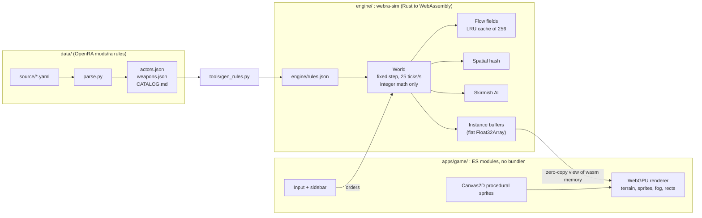

<p align="center">
  
</p>

<p align="center">
  <a href="https://github.com/SherinBloemendaal/webra/actions/workflows/ci.yml"></a>
  
  
  
  
</p>

# WebRA

**WebRA** is a browser-native real-time strategy game inspired by *Command & Conquer: Red Alert* (1996) and the open-source [OpenRA](https://www.openra.net/) engine. The goal is Red Alert gameplay that runs in a browser tab: no install, no plugin, just a deterministic Rust simulation compiled to WebAssembly and drawn with WebGPU.

It is modernised where it helps (large unit counts, flow-field pathfinding, a lockstep-ready simulation) and deliberately old-fashioned where it matters: the look.

## Why the simple art style

WebRA keeps the plain, flat look of 1996: simple shapes, solid team colours and readable silhouettes instead of hyper-detailed textures. Simple images are easier to recognise at a glance and easier to remember, which is exactly what you want when a hundred units are moving across the screen. All sprites are generated procedurally at startup with Canvas2D (at 2x resolution), so the project ships no image assets at all.

## Features (milestone 1)

- [x] Procedural, 180-degree symmetric 2-player maps (clear, rough, rock, water, trees, ore fields), seeded
- [x] Ore harvesting: harvesters search, harvest bale by bale, queue at the refinery dock and unload; ore regrows and spreads; refinery storage limit
- [x] Credits and power (power plants scale with health, low power slows production 3x like OpenRA)
- [x] Classic sidebar production queues (Buildings / Infantry / Vehicles), pay-as-you-build, build-time speedup with multiple factories, queue/cancel with refund
- [x] Building placement with OpenRA rules (adjacency 2 cells, base provider range, footprint with passable bibs, explored ground only)
- [x] Tech tree with real OpenRA prerequisites for 7 factions (Allies, England, France, Germany, Soviet, Russia, Ukraine)
- [x] Buildings: Construction Yard, Power Plant, Ore Refinery, Allied Barracks, Soviet Barracks, War Factory, Service Depot (repairs vehicles for 20% of value)
- [x] Units: Rifle Infantry, Light Tank, Heavy Tank, Ore Truck
- [x] Combat with OpenRA weapon data: range, reload, burst, projectile speed, spread damage with falloff, armour-type versus table, friendly fire, turrets with turn rates
- [x] Classic left-click orders (move, attack, harvest, dock, repair) with custom cursors, attack-move, stop, rally points, control groups
- [x] Sidebar shows every item, with what is still needed to unlock it (or which side or country it belongs to); numpad hotkeys
- [x] Tracked vehicles and ore trucks crush enemy infantry (OpenRA locomotor rules)
- [x] Idle ore trucks resume harvesting by themselves
- [x] Fog of war and shroud, remembered enemy buildings under fog
- [x] Skirmish AI: build order, power management, harvesters, attack waves that grow, base defence
- [x] Victory and defeat
- [x] Stress test mode (tens of thousands of units)
- [x] Deterministic simulation with tests (19 tests, including AI vs AI games played to completion)

## Roadmap

- [x] Helicopters: Chinook, Hind, Black Hawk and Longbow with hovering flight, landing, ammo and rearming at helipads (the Hind and a Soviet helipad are restored from classic Red Alert; see docs/contracts.md section 5)
- [ ] All remaining Red Alert units and buildings from [data/CATALOG.md](data/CATALOG.md) (defences, aircraft, naval, superweapons, support powers)
- [ ] Minimap / radar (requires Radar Dome)
- [ ] Run the simulation in a Web Worker with SharedArrayBuffer; GPU compute for very large crowds
- [ ] Lockstep multiplayer over WebRTC/WebSockets using the deterministic sim and state hash
- [ ] Veterancy, infantry prone, crushing, garrisons
- [ ] Sound effects and music
- [ ] Map editor and loading OpenRA `.oramap` maps
- [ ] Selling and repairing buildings, silos, walls
- [ ] Better AI (scouting, harassment, difficulty levels)
- [ ] Replays (record orders), save/load
- [ ] Mobile/touch controls
- [ ] Hotkey customisation and options menu

## Architecture



**Simulation (`engine/`).** The `webra-sim` crate is compiled to WebAssembly with `wasm-bindgen` and `wasm-pack`. It runs a fixed-step simulation at 25 ticks per second (OpenRA timing) using integer math only: 1024 world units per cell, 1024 angle units per full turn and an integer sine table. No floating point touches game state, so two machines fed the same orders compute the same world. A state hash is exposed for desync checks.

**Pathfinding.** Movement uses flow fields: a Dijkstra integration field per goal cell and locomotor. Fields are cached in an LRU of 256 entries and rebuilt lazily when passability changes. Connectivity labels detect unreachable goals, which snap to the nearest reachable cell. Many units ordered to the same goal share one field.

**Spatial hash.** Rebuilt every tick with a counting sort, it serves crowd separation, target scanning and splash damage.

**Rendering (`apps/game/`).** Plain ES modules, no bundler. The WebGPU renderer uses WGSL shaders in `apps/game/shaders` for terrain, instanced sprites with team colour masks, fog of war and rectangles. Rust writes instance data into flat `Float32Array`s, which are uploaded straight from WebAssembly memory to the GPU.

## Project layout

A monorepo; [docs/contracts.md](docs/contracts.md) defines how the parts fit together.

```
webra/
├── engine/                 webra-sim: deterministic simulation (Rust, compiled to WebAssembly)
│   ├── rules.json          generated rules, embedded in the wasm
│   ├── src/                world, units, combat, production, map, flowfield, vision, ai, render, tests
│   └── examples/           ai_vs_ai.rs (headless match), stress.rs (benchmark), ai_probe.rs
├── apps/
│   ├── game/               browser client, served at /play (ES modules, WebGPU, no bundler)
│   ├── website/            landing site, served at /
│   └── server/             Cloudflare Worker: static hosting, API, multiplayer sessions
├── packages/
│   └── protocol/           multiplayer messages shared by game and server
├── data/                   Red Alert catalog extracted from OpenRA mods/ra
├── tools/                  gen_rules.py, shader-check (naga), check-js.mjs
└── docs/                   contracts, README assets
```

## Getting started

You need a Rust toolchain, `wasm-pack` and Python 3 (only for the static file server and the data tools).

```bash
rustup target add wasm32-unknown-unknown
cargo install wasm-pack
npm install
npm run build:wasm
python3 -m http.server 8080 --directory apps/game
```

Then open <http://localhost:8080> in a browser with WebGPU support: Chrome or Edge 113+, Safari 26+, or Firefox 141+ on Windows.

### Other commands

| Task | Command |
|------|---------|
| Everything CI runs (engine tests, wasm build, JS checks, API tests) | `npm test` |
| Run the simulation tests | `cargo test -p webra-sim --release` |
| Headless AI vs AI match (seed 7) | `cargo run -p webra-sim --release --example ai_vs_ai -- 7` |
| Headless stress benchmark | `cargo run -p webra-sim --release --example stress -- 20000` |
| Regenerate `engine/rules.json` | `python3 tools/gen_rules.py` |
| Validate the WGSL shaders | `cargo run -p shader-check` |

## Controls

| Input | Action |
|-------|--------|
| Left click | Select. With your units selected: give the order (move, attack, harvest, dock or repair); left click one of your own units to select it instead |
| Drag box | Select units. If the box contains combat units, only those are selected (ore trucks stay out of army drags) |
| Double click | Select all units of that type on screen |
| Right click | Clear the selection (or cancel placement / attack-move) |
| Factory selected + left click on the ground | Set its rally point |
| A + left click | Attack-move |
| S | Stop |
| Ctrl + 1..9 | Assign control group |
| 1..9 | Select control group |
| Numpad 1..9 | Build that sidebar card (Shift: 5, Ctrl: cancel one) |
| Numpad + / - / 0 | Next / previous sidebar tab |
| Numpad . | Cancel building placement |
| Arrow keys / screen edges | Pan the camera |
| Middle mouse drag | Pan the camera |
| Mouse wheel | Zoom |
| H or Space | Center on your base |
| Esc | Cancel placement / clear selection |
| Sidebar left click | Build (Shift + click queues 5) |
| Sidebar right click | Cancel (refunds what was paid) |
| Click a finished building in the sidebar | Start placing it |

Every order type has its own cursor (move, attack, attack-move, harvest, dock, repair, rally, select).

## Data

[data/CATALOG.md](data/CATALOG.md) is the full Red Alert catalog extracted from OpenRA's `mods/ra` rules: 94 buildable actors and 77 weapons, with inheritance resolved and the tech tree solved per faction. The machine-readable versions are [data/actors.json](data/actors.json) and [data/weapons.json](data/weapons.json); the original YAML and the scripts that produced them (`parse.py`, `gen_md.py`) live in [data/source](data/source).

`tools/gen_rules.py` picks the actors needed for the current milestone and writes `engine/rules.json`, which is embedded in the WebAssembly module.

## Determinism and performance

- **Fixed step, integer only.** 25 ticks per second, world units of 1024 per cell, angles of 1024 per turn, an integer sine table and a seeded RNG. This is what will make lockstep multiplayer possible: peers only exchange orders and compare state hashes.
- **Tested.** The test suite includes full AI vs AI games played to completion.
- **Shared flow fields.** A crowd ordered to one goal costs one field, not one path search per unit.
- **Cheap neighbourhood queries.** The per-tick spatial hash keeps separation, targeting and splash damage close to linear.
- **Zero-copy rendering.** Instance buffers go from WebAssembly memory to the GPU without JavaScript-side object churn.
- **Numbers.** Native benchmark of two armies attack-moving into each other (`cargo run -p webra-sim --release --example stress -- 20000`), against a 40 ms tick budget:

  | Units | Average | Worst tick |
  |------:|--------:|-----------:|
  | 10,000 | 3.5 ms | 11 ms |
  | 20,000 | 6.9 ms | 37 ms |
  | 50,000 | 18.6 ms | 74 ms |

  WebAssembly runs the same code somewhat slower than native; the in-game HUD shows the live ms per tick.

## Credits

- **[OpenRA](https://github.com/OpenRA/OpenRA)**: the open-source reimplementation of the classic Westwood RTS games. WebRA's gameplay values (costs, build times, health, armour, weapons, prerequisites, timing) come from OpenRA's `mods/ra` rules, which are licensed under GPLv3. Many thanks to the OpenRA contributors.
- **Westwood Studios and Electronic Arts**: for the original *Command & Conquer: Red Alert*.

*Command & Conquer* and *Red Alert*, and the names of their units, buildings and factions, are trademarks or property of Electronic Arts. WebRA is an unofficial fan project and is not affiliated with or endorsed by Electronic Arts or the OpenRA project. It contains **no original game assets**: all graphics are generated procedurally by the game at runtime.

## License

WebRA is licensed under the **GNU General Public License v3.0 or later** (GPL-3.0-or-later), because it derives its game data from OpenRA's GPLv3 rules. See [LICENSE](LICENSE) for the full text.
